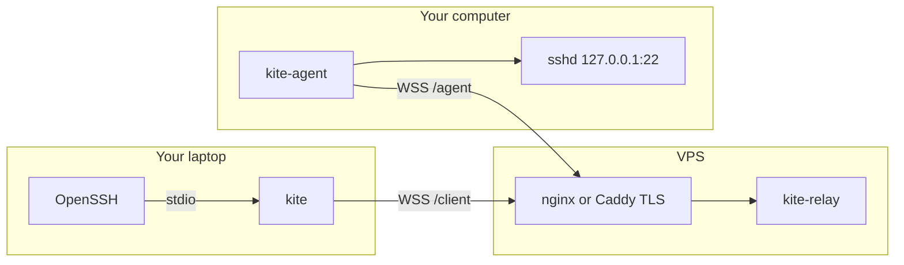
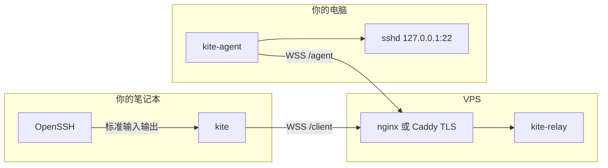

# kite

kite is a small self-hosted tunnel that carries SSH over a WebSocket (plain WS, or WSS when TLS is terminated in front). It is meant for personal access to your own computers: a relay with a public name, an agent on each machine that dials out, and an OpenSSH `ProxyCommand` on the client. One static binary each, no Cgo.

It is a lightweight alternative to frp, chisel, or Tailscale when all you want is SSH to machines you already administer.

## Binaries

| Binary | Role |
| --- | --- |
| `kite-relay` | Runs on a Linux VPS. Accepts long-lived agent WebSockets and forwards client sessions to the agent with the matching name. |
| `kite-agent` | Runs on each of your computers (Windows, Linux, macOS). Dials out to the relay and forwards streams only to the local SSH server. Reconnects with backoff. |
| `kite` | OpenSSH `ProxyCommand`. Connects to the relay, asks for one agent by name, and splices stdin/stdout so `ssh` and tools built on it work as usual. |

## Architecture



The usual deployment is plain WebSocket on `127.0.0.1:8080`, with nginx or Caddy terminating TLS. kite-relay can serve TLS itself when both `TLS_CERT_FILE` and `TLS_KEY_FILE` are set.

One WebSocket per agent carries many SSH streams. Each frame is a 5-byte header (1-byte type, 4-byte big-endian stream id) plus a payload of at most 256 KiB. An agent connection holds at most 64 streams. Ping (type 10) and pong (type 11) are exchanged every 20 seconds. A connection with no received frames for `IDLE_TIMEOUT` (default 90s) is dropped. Those application heartbeats, not TCP keepalives, are what keep an idle tunnel open through a reverse proxy. An upgraded socket that never sends its hello is closed after 10 seconds with `handshake timeout`. The idle timer does not start until authentication succeeds.

Agents present one shared `REGISTRATION_KEY`. Clients may present that same key, or a per-client token from `kite connect`. The relay compares registration keys in constant time and stores only a hash of each client token. A newer agent with the same name replaces the previous connection. Pairing uses two extra frame types (12 and 13) on the agent connection. A peer that does not know them ignores the frame and the other side reports that pairing is unsupported.

The agent dials only its configured `LOCAL_SSH_ADDR` (default `127.0.0.1:22`). Open frames do not carry an address. The relay cannot point the agent at another host.

## Secrets

Set `REGISTRATION_KEY` and `RELAY_ADDR` with environment variables, or with a config file that stays out of git (`~/.config/kite/config.yaml`, or `--config` / `KITE_CONFIG` pointing at a gitignored file). Never commit them. A paired laptop stores its client token in that same file and its private key in `~/.ssh/kite_<agent>`. The pairing code is short-lived and is not a credential you keep.

Do not commit real registration keys, real domains, public IPs, TLS certificates, or private keys. The files in this repository use placeholders (`CHANGE_ME`, `tunnel.example.com`). kite refuses to start while the key is still `CHANGE_ME`.

`.gitignore` excludes `.env`, `*.pem`, `*.key`, `*.crt`, `config.yaml`, `config.yml`, `config.toml`, and `config.json`. Tracked examples live at `config.example.yaml` and `deploy/*.example`.

On Windows the service reads `%ProgramData%\kite\config.yaml`, unless `kite-agent install --config` recorded another path outside your user profile. That file is created on the machine. Do not commit it.

Copy `config.example.yaml` if you want a file. Environment variables override the file. Flags override both.

## Quick start

Build, or download a release (below):

```sh
make all
# bin/kite  bin/kite-agent  bin/kite-relay
```

The path is: install the relay, run `kite-agent install` on the computer you want to reach (it sets up sshd), run `kite-agent pair` there, run `kite connect CODE` on the laptop, then `ssh <name>`.

### 1. Relay

On the VPS, install `kite-relay` and create `/etc/kite/relay.env` from `deploy/relay.env.example`. Put a long random `REGISTRATION_KEY` in that file and `chmod 600` it. `STATE_DIR` defaults to `/var/lib/kite` (hashed client tokens). The unit's `StateDirectory=kite` creates that directory.

```sh
sudo install -m 755 bin/kite-relay /usr/local/bin/kite-relay
sudo install -d -m 700 /etc/kite /var/lib/kite
sudo cp deploy/relay.env.example /etc/kite/relay.env
sudoedit /etc/kite/relay.env
sudo cp deploy/kite-relay.service /etc/systemd/system/kite-relay.service
sudo systemctl daemon-reload
sudo systemctl enable --now kite-relay
```

Default listen address is `127.0.0.1:8080` with no TLS. Put nginx or Caddy in front so `/agent`, `/client`, `/pair`, and `/pair/redeem` all reach kite-relay:

- `deploy/nginx-kite.conf` passes through the WebSocket upgrade (`Upgrade` and `Connection`, `proxy_http_version 1.1`), sets `proxy_buffering off`, and uses 24 hour `proxy_read_timeout` / `proxy_send_timeout`.
- `deploy/Caddyfile` uses `reverse_proxy` with `flush_interval -1` and the same long timeouts.

`GET /healthz` returns `ok`. Leave `TLS_CERT_FILE` and `TLS_KEY_FILE` unset when a proxy does TLS.

### 2. Controlled machine

Set the relay URL, the registration key, and a name, then install. `install` checks the local SSH server and fixes it. The agent dials `127.0.0.1:22` only, so install does not add a firewall rule for port 22.

```sh
export RELAY_ADDR="wss://tunnel.example.com/agent"
export REGISTRATION_KEY="CHANGE_ME"   # replace; install refuses this placeholder
export AGENT_NAME="my-pc"
export SSH_USER="me"                  # account that should accept the SSH key
sudo -E kite-agent install
kite-agent pair
```

`pair` prints a one-time code such as `ABCD-EFGH` (10 minutes). It is not the registration key. The installing user can run `pair` without a further elevation prompt when the service is running and the control file is readable. If it is not, `sudo kite-agent pair` uses the registration key from the environment. The agent must be connected to the relay.

What `install` does to sshd, and does again if you re-run it:

- Windows (elevated): if OpenSSH Server is missing, `Add-WindowsCapability -Online -Name OpenSSH.Server~~~~0.0.1.0`. `sshd` is set to startup type Automatic and started. A Manual sshd comes up after reboot as stopped, so the tunnel connects and `127.0.0.1:22` is refused. Install always sets Automatic.
- Linux: if `openssh-server` is missing, root runs the distro command (`apt-get install -y openssh-server`, `dnf install -y openssh-server`, `pacman -S --noconfirm openssh`, or `apk add openssh`) and enables the service (`ssh` on Debian/Ubuntu, `sshd` elsewhere). Without root, the same command is printed.
- macOS: if Remote Login is off, root runs `systemsetup -setremotelogin on`. Without root, that command is printed with `sudo`.

`kite-agent setup` is the same SSH check without registering the agent. `--skip-ssh-setup` skips it during install.

If you did not set `LOCAL_SSH_ADDR` or `--local`, install reads `sshd_config` (including `Include` directories) and the addresses sshd is actually listening on. A loopback socket wins. A wildcard `ListenAddress` still dials `127.0.0.1`. The chosen address is written as `local_ssh_addr` with `local_ssh_addr_auto: true`. An address you set yourself is left alone.

While the agent is running, a failed dial of that address is retried at most once every 30 seconds. If sshd is stopped, root (or the Windows service) starts it and sets Automatic on Windows. If the saved address was auto-detected and sshd has moved, the agent switches and records `port changed from X to Y`. `kite-agent status` prints the last result: `ok`, `sshd stopped`, `started by kite`, `port changed from X to Y`, or `failed`.

On Linux, root `install` also writes `/etc/kite/agent.env` (mode 0600), copies the binary to `/usr/local/bin/kite-agent`, and enables `kite-agent.service`. On macOS, root `install` bootstraps a LaunchDaemon that reads `/etc/kite/agent.env`. On Windows, `install` registers the Service Control Manager service described under Manual setup.

### 3. Laptop

The pairing code does not contain the relay address. Pass it once:

```sh
kite connect --relay wss://tunnel.example.com ABCD-EFGH
ssh my-pc
```

`kite connect` generates an ed25519 key on this computer (the private key is never sent), redeems the code, and stores:

- the private key at `~/.ssh/kite_my-pc` (mode 0600)
- a per-client token in `~/.config/kite/config.yaml` (not the registration key)
- a `Host my-pc` block in `~/.ssh/config` (`User`, `IdentityFile`, `IdentitiesOnly yes`, `ProxyCommand` with the absolute path to `kite`). An existing file is copied to `config.bak.<timestamp>` first. An existing `Host my-pc` block is left unchanged.

The relay asks the agent, over the agent's existing connection, to append the public key. On Windows, an administrator account uses `C:\ProgramData\ssh\administrators_authorized_keys` (SYSTEM and Administrators only). Any other account uses that user's `~/.ssh/authorized_keys`. Linux and macOS use `~/.ssh/authorized_keys` with mode 0700 on `.ssh` and 0600 on the file. The comment is `kite-pair <label> <date>`.

Then:

```sh
ssh my-pc exit
```

`scp`, `sftp`, and `git` over SSH use the same host. The name `connect` is reserved by the `kite` command and cannot be an agent name.

### Revoke and rotate

On the controlled machine, list or remove keys kite added:

```sh
kite-agent unpair --list
kite-agent unpair --revoke laptop
```

On the relay, client tokens are separate from those SSH keys. `kite-relay tokens list` prints id, agent, label, SSH user, and time. It does not print the token. `kite-relay tokens revoke <id-or-label>` drops the token. Do both when retiring a laptop.

To rotate the agent registration key without cutting off paired laptops (they no longer use it):

1. On the relay, set `REGISTRATION_KEY_PREVIOUS` to the current key and `REGISTRATION_KEY` to the new secret. Restart kite-relay. Both keys are accepted.
2. Put the new key in each agent's config (`SSH_USER` unchanged) and restart kite-agent.
3. Remove `REGISTRATION_KEY_PREVIOUS` and restart kite-relay.

A relay restart drops outstanding pairing codes. It does not drop client tokens; those live in `STATE_DIR/clients.json` as hashes.

Agents and clients from v0.1.0-rc.2 keep working with `REGISTRATION_KEY`. They do not understand pairing. `kite-agent pair` against an older agent fails with a message to upgrade that agent. An old relay answers `POST /pair` with 404, and `kite connect` says the relay does not support pairing.

## Manual setup

Use this when you want to install the service yourself, or when a laptop should keep using the shared `REGISTRATION_KEY` instead of `kite connect`.

### Relay by hand

The commands in step 1 are the manual relay install. To terminate TLS inside kite-relay, set both `TLS_CERT_FILE` and `TLS_KEY_FILE`.

### Agent by hand

`AGENT_NAME` must match the `Host` alias. The agent never dials anywhere except `LOCAL_SSH_ADDR`.

Linux, with `/etc/kite/agent.env` copied from `deploy/agent.env.example`:

```sh
sudo install -m 755 bin/kite-agent /usr/local/bin/kite-agent
sudo cp deploy/kite-agent.service /etc/systemd/system/kite-agent.service
sudo systemctl daemon-reload
sudo systemctl enable --now kite-agent
```

macOS user agent: copy `deploy/agent.env.example` to `~/.config/kite/agent.env` (`chmod 600`), install the binary to `/usr/local/bin/kite-agent`, then:

```sh
cp deploy/com.kite.agent.plist ~/Library/LaunchAgents/
launchctl load ~/Library/LaunchAgents/com.kite.agent.plist
```

The plist has no secrets. It sources `~/.config/kite/agent.env`. Do not load that user agent and the root LaunchDaemon at the same time; they would fight over the same agent name.

Windows runs `kite-agent` as a service. It starts at boot, including when nobody is logged on, and it does not open a console window. From an elevated PowerShell (Run as administrator):

```powershell
$env:RELAY_ADDR = "wss://tunnel.example.com/agent"
$env:REGISTRATION_KEY = "CHANGE_ME"
$env:AGENT_NAME = "my-pc"
$env:SSH_USER = "me"
.\kite-agent.exe install
.\kite-agent.exe status
.\kite-agent.exe pair
```

Replace the placeholders before running. `install` refuses `CHANGE_ME` and `tunnel.example.com`.

`install` copies the binary to `%ProgramFiles%\kite\kite-agent.exe`, writes `%ProgramData%\kite\config.yaml`, and registers service `kite-agent` as automatic (delayed). The service command line is the executable plus `--config`. The registration key stays in that file. Its ACL grants SYSTEM, Administrators, and the user who ran `install`. LocalSystem does not see your shell environment. The same ACL lets that user read the control file, so `kite-agent pair` does not need a second elevation prompt while the service is running.

```powershell
kite-agent status      # no elevation required
kite-agent list        # no elevation required; every kite-agent and kite-agent-* service
kite-agent pair        # no elevation required for the installing user while the service is running
kite-agent stop        # elevated
kite-agent start       # elevated
kite-agent restart     # elevated
kite-agent uninstall   # elevated; leaves the config file in place
```

Logs are `%ProgramData%\kite\kite-agent.log`. `uninstall` does not delete the config file.

A second service can run beside the stable one. Give it its own `AGENT_NAME`:

```powershell
.\kite-agent.exe install --service-name kite-agent-test
```

Its files live under `%ProgramFiles%\kite\kite-agent-test\` and `%ProgramData%\kite\kite-agent-test\`. Only the default name removes an old logon scheduled task.

```powershell
.\kite-agent.exe upgrade --from C:\path\to\new\kite-agent.exe
```

`upgrade` schedules a one-shot SYSTEM task that swaps the exe even if this SSH session drops. The result is `%ProgramData%\kite\upgrade.log`.

`deploy/install-kite-agent.ps1` calls the same `install`. Foreground debugging still opens a console; stop the service first.

### SSH client by hand

OpenSSH does not expand `$VARS` inside `ProxyCommand`. `%n` is the `Host` alias and must equal `AGENT_NAME`. A paired laptop does not need this block; `kite connect` writes it. A legacy client still sends `REGISTRATION_KEY`:

```
Host my-pc
  User me
  ProxyCommand kite %n
```

```sh
# ~/.config/kite/client.env  (gitignored copy of deploy/client.env.example)
set -a
. "$HOME/.config/kite/client.env"
set +a
ssh my-pc
```

## Download

Release tags `v*` build static binaries for `linux/amd64`, `linux/arm64`, `windows/amd64`, `darwin/amd64`, and `darwin/arm64`. Grab them from the [GitHub Releases](https://github.com/zzzbug01/kite/releases) page. Linux and macOS archives are `.tar.gz`. Windows is `.zip` and also contains `WINDOWS.txt` plus `install-kite-agent.ps1`. `kite-agent.exe install` is enough to register the service. `SHA256SUMS` lists every file.

A pull request, and any push to a branch other than `main`, also uploads those builds on the `ci` workflow run. They are kept for 14 days and are not a GitHub Release. Open the run from the commit's checks and download the artifact whose name ends with that commit's short SHA, for example `kite-windows-amd64-5e5ec23`. The Windows artifact is the release zip layout: `kite.exe`, `kite-agent.exe`, `kite-relay.exe`, `WINDOWS.txt`, and `install-kite-agent.ps1`. `kite-agent.exe --version` prints the same short SHA. Linux and macOS artifacts are the `.tar.gz` for that commit.

```sh
tar -xzf kite_v0.1.0_linux_amd64.tar.gz
sudo install -m 755 kite kite-agent kite-relay /usr/local/bin
```

## Build

Requires Go 1.23 or newer.

```sh
make all     # CGO_ENABLED=0 binaries in bin/
make test    # go vet ./... and go test -race ./...
make cross   # linux/amd64, linux/arm64, windows/amd64, darwin/amd64, darwin/arm64
```

`make test` does not force `CGO_ENABLED=0`, because the race detector needs cgo. Release binaries and `make cross` always set `CGO_ENABLED=0`.

## Cut a release

Tag and push. GitHub Actions (`.github/workflows/release.yml`) cross-compiles, packages, and attaches the archives to a GitHub Release. This repository does not ship a pre-made tag. A tag that contains a hyphen is published as a GitHub prerelease.

```sh
git tag v0.1.0-rc.2
git push origin v0.1.0-rc.2
```

`v0.1.0-rc.2` is a prerelease. `v0.1.0` is a stable release.

## Configuration

| Variable | Binary | Default |
| --- | --- | --- |
| `LISTEN_ADDR` | relay | `127.0.0.1:8080` |
| `REGISTRATION_KEY` | relay, agent, legacy client | required for the relay and agents |
| `REGISTRATION_KEY_PREVIOUS` | relay | unset; accepted during rotation |
| `STATE_DIR` | relay | `/var/lib/kite` |
| `TLS_CERT_FILE`, `TLS_KEY_FILE` | relay | unset (plain WS) |
| `IDLE_TIMEOUT` | all | `90s` |
| `RELAY_ADDR` | agent, client | required, `ws://` or `wss://` |
| `AGENT_NAME` | agent | required |
| `LOCAL_SSH_ADDR` | agent | `127.0.0.1:22` |
| `SSH_USER` | agent | account that receives paired keys |
| `TRUSTED_PROXIES` | relay | empty: trust X-Forwarded-For only from loopback, using the right-most address |

Flags: `--listen`, `--registration-key`, `--registration-key-previous`, `--state-dir`, `--tls-cert`, `--tls-key`, `--idle-timeout`, `--relay`, `--name`, `--local`, `--ssh-user`, `--config`. A URL with no path becomes `/agent` for kite-agent and `/client` for kite. `kite-agent install` also accepts `--install-dir` and `--skip-ssh-setup`. `kite connect` accepts `--relay` and `--label`. `kite-agent pair` accepts `--ttl` (default 10m, maximum 30m).

On Windows, when no `--config` / `KITE_CONFIG` is set and the user config files are absent, kite-agent also reads `%ProgramData%\kite\config.yaml`. The installed service always passes `--config` so it does not depend on that search.

---

# kite（中文）

kite 是一个自托管的轻量隧道，用 WebSocket 承载 SSH（代理终结 TLS 时就是 WSS）。它用来访问你自己的电脑：公网机器上跑中继，每台电脑上的 agent 主动向外连接，本机用 OpenSSH 的 `ProxyCommand` 接入。三个静态二进制，不依赖 Cgo。

只想 SSH 到自己管理的机器时，它可以作为 frp、chisel 或 Tailscale 的轻量替代。

## 三个程序

| 程序 | 作用 |
| --- | --- |
| `kite-relay` | 跑在 Linux VPS 上。接受 agent 的长连接，把客户端会话转给同名 agent。 |
| `kite-agent` | 跑在你的每台电脑上（Windows、Linux、macOS）。主动连向中继，只把流量转给本机 SSH。断线按退避重连。 |
| `kite` | OpenSSH 的 `ProxyCommand`。连上中继，按名字找到 agent，把标准输入输出对接过去，`ssh` 以及基于它的工具可以照常使用。 |

## 架构



常见部署是中继在 `127.0.0.1:8080` 上提供明文 WebSocket，由 nginx 或 Caddy 终结 TLS。只有同时设置 `TLS_CERT_FILE` 和 `TLS_KEY_FILE` 时，kite-relay 才自己提供 TLS。

每个 agent 一条 WebSocket，上面复用多路 SSH。帧格式是 5 字节头（1 字节类型 + 4 字节大端流编号）再加最多 256 KiB 的载荷。一条 agent 连接最多 64 路。每 20 秒交换一次 ping（类型 10）和 pong（类型 11）。`IDLE_TIMEOUT`（默认 90 秒）内没有收到任何帧就断开。穿过反向代理时，靠的是这个应用层心跳，而不是 TCP keepalive。升级成 WebSocket 之后如果一直不发 hello，10 秒后会关掉，原因是 `handshake timeout`。认证成功之前不开始空闲计时。

agent 出示共享的 `REGISTRATION_KEY`。客户端可以出示同一把密钥，也可以出示 `kite connect` 发的每客户端令牌。中继用常数时间比较注册密钥，客户端令牌只存哈希。同名 agent 新连接会替换旧连接。配对在 agent 连接上多用两种帧（12 和 13）。不认识的一端会忽略这种帧，另一端会说明对方还不支持配对。

agent 只拨自己配置的 `LOCAL_SSH_ADDR`（默认 `127.0.0.1:22`）。打开流的帧里不带地址，中继不能让 agent 去连别的地方。

## 密钥

`REGISTRATION_KEY` 和 `RELAY_ADDR` 用环境变量设置，或者放在不进 git 的配置文件里（`~/.config/kite/config.yaml`，或 `--config` / `KITE_CONFIG` 指向被 gitignore 的文件）。不要把它们提交进仓库。配对过的笔记本把客户端令牌放在同一个配置文件里，把私钥放在 `~/.ssh/kite_<agent>`。配对码是短时的，不用保存。

不要提交真实的注册密钥、真实域名、公网 IP、TLS 证书或私钥。仓库里的示例只用占位符（`CHANGE_ME`、`tunnel.example.com`）。密钥如果还是 `CHANGE_ME`，程序会拒绝启动。

`.gitignore` 排除 `.env`、`*.pem`、`*.key`、`*.crt`、`config.yaml`、`config.yml`、`config.toml` 和 `config.json`。会进仓库的示例是 `config.example.yaml` 和 `deploy/*.example`。

Windows 服务读取 `%ProgramData%\kite\config.yaml`，除非 `kite-agent install --config` 指定了用户配置目录以外的路径。这个文件在本机生成，不要提交。

需要文件时复制 `config.example.yaml`。环境变量覆盖文件，命令行参数再覆盖环境变量。

## 快速开始

编译，或从下面的 Release 下载：

```sh
make all
# bin/kite  bin/kite-agent  bin/kite-relay
```

顺序是：装好中继，在要被连接的电脑上运行 `kite-agent install`（它会装好 sshd），在那台电脑上运行 `kite-agent pair`，在笔记本上运行 `kite connect 配对码`，然后 `ssh <名字>`。

### 1. 中继

在 VPS 上安装 `kite-relay`，用 `deploy/relay.env.example` 生成 `/etc/kite/relay.env`，写入一长串随机 `REGISTRATION_KEY`，并 `chmod 600`。`STATE_DIR` 默认是 `/var/lib/kite`（只保存客户端令牌的哈希）。单元里的 `StateDirectory=kite` 会创建这个目录。

```sh
sudo install -m 755 bin/kite-relay /usr/local/bin/kite-relay
sudo install -d -m 700 /etc/kite /var/lib/kite
sudo cp deploy/relay.env.example /etc/kite/relay.env
sudoedit /etc/kite/relay.env
sudo cp deploy/kite-relay.service /etc/systemd/system/kite-relay.service
sudo systemctl daemon-reload
sudo systemctl enable --now kite-relay
```

默认监听 `127.0.0.1:8080`，不启用 TLS。前面加 nginx 或 Caddy，让 `/agent`、`/client`、`/pair` 和 `/pair/redeem` 都转到 kite-relay：

- `deploy/nginx-kite.conf` 透传 WebSocket 升级（`Upgrade` 和 `Connection`，`proxy_http_version 1.1`），关闭 `proxy_buffering`，读写超时 24 小时。
- `deploy/Caddyfile` 使用 `reverse_proxy`，`flush_interval -1`，超时同样很长。

`GET /healthz` 返回 `ok`。由代理做 TLS 时不要设置 `TLS_CERT_FILE` 和 `TLS_KEY_FILE`。

### 2. 被控电脑

设置中继地址、注册密钥和名字，然后安装。`install` 会检查本机 SSH 并把它修好。agent 只拨 `127.0.0.1:22`，所以不会为 22 端口添加入站防火墙规则。

```sh
export RELAY_ADDR="wss://tunnel.example.com/agent"
export REGISTRATION_KEY="CHANGE_ME"   # 先换成真实密钥，占位符会被拒绝
export AGENT_NAME="my-pc"
export SSH_USER="me"                  # 接受 SSH 公钥的本机账户
sudo -E kite-agent install
kite-agent pair
```

`pair` 打印一次性配对码，例如 `ABCD-EFGH`（10 分钟，用过即废）。它不是注册密钥。服务在跑、而且控制文件对安装者可读时，不需要再提权。否则 `sudo kite-agent pair` 会用环境里的注册密钥向中继要码。agent 必须已经连上中继。

`install` 对 sshd 做的事，再跑一次也一样：

- Windows（提升权限）：没有 OpenSSH Server 就执行 `Add-WindowsCapability -Online -Name OpenSSH.Server~~~~0.0.1.0`。把 `sshd` 设为自动启动并启动它。启动类型如果是手动，重启后 kite 能连上中继，但 `127.0.0.1:22` 会被拒绝。install 总会把它设成 Automatic。
- Linux：没有 `openssh-server` 时，root 会按发行版执行安装命令（`apt-get install -y openssh-server`、`dnf install -y openssh-server`、`pacman -S --noconfirm openssh` 或 `apk add openssh`），并 enable 服务（Debian/Ubuntu 是 `ssh`，其它是 `sshd`）。不是 root 就只打印这条命令。
- macOS：远程登录关着时，root 执行 `systemsetup -setremotelogin on`。不是 root 就打印带 `sudo` 的同一条命令。

`kite-agent setup` 只做 SSH 检查，不注册 agent。`install --skip-ssh-setup` 可以跳过这一步。

如果没有设置 `LOCAL_SSH_ADDR` 或 `--local`，install 会读 `sshd_config`（包括 `Include` 目录）以及 sshd 当前正在监听的地址。优先用回环地址。`ListenAddress` 是任意地址时仍然拨 `127.0.0.1`。结果写入 `local_ssh_addr`，并标上 `local_ssh_addr_auto: true`。你自己写的地址不会被改掉。

agent 运行中如果拨这个地址失败，最多每 30 秒处理一次。sshd 没在跑时，root（Windows 上是服务）会尝试启动它，Windows 上还会把启动类型设成 Automatic。如果地址是自动检测的、而 sshd 已经换了端口，agent 会改过去，并记下 `port changed from X to Y`。`kite-agent status` 显示最近一次结果：`ok`、`sshd stopped`、`started by kite`、`port changed from X to Y` 或 `failed`。

在 Linux 上，root 执行的 `install` 还会写入 `/etc/kite/agent.env`（权限 0600），把程序拷到 `/usr/local/bin/kite-agent`，并 enable `kite-agent.service`。在 macOS 上，root 执行的 `install` 会加载一个读取 `/etc/kite/agent.env` 的 LaunchDaemon。在 Windows 上，`install` 注册下面「手动安装」里说的服务。

### 3. 笔记本

配对码里没有中继地址，第一次要带上：

```sh
kite connect --relay wss://tunnel.example.com ABCD-EFGH
ssh my-pc
```

`kite connect` 在这台电脑上生成 ed25519 密钥（私钥不会发出去），兑换配对码，并写入：

- 私钥 `~/.ssh/kite_my-pc`（权限 0600）
- `~/.config/kite/config.yaml` 里的每客户端令牌（不是注册密钥）
- `~/.ssh/config` 里的 `Host my-pc`（`User`、`IdentityFile`、`IdentitiesOnly yes`，`ProxyCommand` 用 kite 的绝对路径）。已有文件会先复制成 `config.bak.<时间>`。已经有同名 `Host` 时不会再加一块。

中继通过 agent 现有的连接，让它把公钥追加进去。Windows 上管理员账户写入 `C:\ProgramData\ssh\administrators_authorized_keys`（只给 SYSTEM 和管理员）。其它账户写入该用户的 `~/.ssh/authorized_keys`。Linux 和 macOS 使用 `~/.ssh/authorized_keys`，目录 0700，文件 0600。注释是 `kite-pair <标签> <日期>`。

然后：

```sh
ssh my-pc exit
```

`scp`、`sftp` 和走 SSH 的 `git` 用同一个主机名。`connect` 这个名字被 `kite` 命令占用，不能当作 agent 名。

### 撤销和轮换

在被控电脑上列出或删掉 kite 加过的公钥：

```sh
kite-agent unpair --list
kite-agent unpair --revoke laptop
```

中继上的客户端令牌和这些 SSH 公钥是两回事。`kite-relay tokens list` 打印 id、agent、标签、SSH 用户和时间，不打印令牌本身。`kite-relay tokens revoke <id 或标签>` 作废令牌。退役一台笔记本时两步都做。

轮换 agent 的注册密钥时，已经配对的笔记本不再用这把密钥：

1. 在中继上把 `REGISTRATION_KEY_PREVIOUS` 设成当前密钥，把 `REGISTRATION_KEY` 设成新密钥，重启 kite-relay。两把密钥都会被接受。
2. 把新密钥写进每台 agent 的配置（`SSH_USER` 不用改），重启 kite-agent。
3. 删掉 `REGISTRATION_KEY_PREVIOUS`，再重启 kite-relay。

中继重启会丢掉还没兑换的配对码，不会丢掉客户端令牌。令牌以哈希形式放在 `STATE_DIR/clients.json`。

v0.1.0-rc.2 的 agent 和客户端继续用 `REGISTRATION_KEY`，它们不会配对。对旧 agent 执行 `kite-agent pair` 会得到明确的升级提示。旧中继对 `POST /pair` 返回 404，`kite connect` 会说明这台中继还不支持配对。

## 手动安装

想自己装服务，或者笔记本继续用共享的 `REGISTRATION_KEY` 而不是 `kite connect` 时，走这里。

### 手动装中继

第 1 步的命令就是手动安装。要让 kite-relay 自己终结 TLS，同时设置 `TLS_CERT_FILE` 和 `TLS_KEY_FILE`。

### 手动装 agent

`AGENT_NAME` 必须和 SSH 的 `Host` 别名一致。agent 除了 `LOCAL_SSH_ADDR` 不会拨其它地址。

Linux：把 `deploy/agent.env.example` 复制为 `/etc/kite/agent.env` 后：

```sh
sudo install -m 755 bin/kite-agent /usr/local/bin/kite-agent
sudo cp deploy/kite-agent.service /etc/systemd/system/kite-agent.service
sudo systemctl daemon-reload
sudo systemctl enable --now kite-agent
```

macOS 用户代理：把 `deploy/agent.env.example` 复制到 `~/.config/kite/agent.env`（`chmod 600`），二进制放到 `/usr/local/bin/kite-agent`，然后：

```sh
cp deploy/com.kite.agent.plist ~/Library/LaunchAgents/
launchctl load ~/Library/LaunchAgents/com.kite.agent.plist
```

这个 plist 里没有密钥，它会读取 `~/.config/kite/agent.env`。不要同时加载这个用户代理和 root 安装的 LaunchDaemon，两边会抢同一个 agent 名。

Windows 上 kite-agent 作为服务运行。开机就会启动，不需要有人登录，也不会弹出控制台。在提升权限的 PowerShell 里：

```powershell
$env:RELAY_ADDR = "wss://tunnel.example.com/agent"
$env:REGISTRATION_KEY = "CHANGE_ME"
$env:AGENT_NAME = "my-pc"
$env:SSH_USER = "me"
.\kite-agent.exe install
.\kite-agent.exe status
.\kite-agent.exe pair
```

运行前换掉占位符。`install` 会拒绝 `CHANGE_ME` 和 `tunnel.example.com`。

`install` 把程序拷到 `%ProgramFiles%\kite\kite-agent.exe`，写入 `%ProgramData%\kite\config.yaml`，并把服务 `kite-agent` 注册为自动（延迟）启动。服务命令行只有程序路径和 `--config`。注册密钥留在那个文件里。ACL 给 SYSTEM、Administrators 和执行 install 的用户。LocalSystem 看不到你的用户环境。同一份 ACL 让这个用户能读控制文件，所以服务在跑时 `kite-agent pair` 不需要再提权。

```powershell
kite-agent status      # 不需要提升权限
kite-agent list        # 不需要提升权限；列出 kite-agent 和 kite-agent-*
kite-agent pair        # 服务在跑时，安装者不用再提权
kite-agent stop        # 需要提升权限
kite-agent start       # 需要提升权限
kite-agent restart     # 需要提升权限
kite-agent uninstall   # 需要提升权限；配置文件会留下来
```

日志是 `%ProgramData%\kite\kite-agent.log`。`uninstall` 不删除配置文件。

可以在稳定服务旁边再装一个实例，并使用不同的 `AGENT_NAME`：

```powershell
.\kite-agent.exe install --service-name kite-agent-test
```

它的文件在 `%ProgramFiles%\kite\kite-agent-test\` 和 `%ProgramData%\kite\kite-agent-test\`。只有默认名称会删除旧的登录计划任务。

```powershell
.\kite-agent.exe upgrade --from C:\path\to\new\kite-agent.exe
```

`upgrade` 注册一个以 SYSTEM 运行的一次性任务，即使这条 SSH 会话断开也会换掉 exe。结果写在 `%ProgramData%\kite\upgrade.log`。

`deploy/install-kite-agent.ps1` 调用同一条 `install`。前台调试仍会打开控制台，先停掉服务。

### 手动配置 SSH 客户端

OpenSSH 不会展开 `ProxyCommand` 里的 `$变量`。`%n` 是 `Host` 别名，必须等于 `AGENT_NAME`。配对过的笔记本不用手写这块；`kite connect` 会写。仍使用 `REGISTRATION_KEY` 的旧客户端：

```
Host my-pc
  User me
  ProxyCommand kite %n
```

```sh
# ~/.config/kite/client.env  （deploy/client.env.example 的副本，不要提交）
set -a
. "$HOME/.config/kite/client.env"
set +a
ssh my-pc
```

## 下载

标签 `v*` 会为 `linux/amd64`、`linux/arm64`、`windows/amd64`、`darwin/amd64`、`darwin/arm64` 打静态二进制。从 [GitHub Releases](https://github.com/zzzbug01/kite/releases) 下载。Linux 和 macOS 是 `.tar.gz`，Windows 是 `.zip`，里面还有 `WINDOWS.txt` 和 `install-kite-agent.ps1`。注册服务只需要 `kite-agent.exe install`。`SHA256SUMS` 列出全部文件。

拉取请求，以及推送到 `main` 以外分支的提交，也会在 `ci` 工作流里上传这些构建。它们保留 14 天，不是 GitHub Release。从该提交的检查项打开这次运行，下载名称以该提交短 SHA 结尾的产物，例如 `kite-windows-amd64-5e5ec23`。Windows 产物和发布用的 zip 内容一样：`kite.exe`、`kite-agent.exe`、`kite-relay.exe`、`WINDOWS.txt` 和 `install-kite-agent.ps1`。`kite-agent.exe --version` 打印同一个短 SHA。Linux 和 macOS 产物是该提交的 `.tar.gz`。

```sh
tar -xzf kite_v0.1.0_linux_amd64.tar.gz
sudo install -m 755 kite kite-agent kite-relay /usr/local/bin
```

## 编译

需要 Go 1.23 或更新版本。

```sh
make all     # bin/ 下的 CGO_ENABLED=0 二进制
make test    # go vet ./... 以及 go test -race ./...
make cross   # linux/amd64、linux/arm64、windows/amd64、darwin/amd64、darwin/arm64
```

`make test` 不会强制 `CGO_ENABLED=0`，因为竞态检测需要 cgo。发布用的二进制和 `make cross` 始终设置 `CGO_ENABLED=0`。

## 打一个版本

打标签并推送。GitHub Actions（`.github/workflows/release.yml`）会交叉编译、打包，并把压缩包挂到 GitHub Release 上。这个仓库本身不带现成的 tag。标签名里带连字符时，发布会被标成 GitHub prerelease。

```sh
git tag v0.1.0-rc.2
git push origin v0.1.0-rc.2
```

`v0.1.0-rc.2` 是预发布。`v0.1.0` 是正式版。

## 配置

| 变量 | 程序 | 默认 |
| --- | --- | --- |
| `LISTEN_ADDR` | 中继 | `127.0.0.1:8080` |
| `REGISTRATION_KEY` | 中继、agent、旧客户端 | 中继和 agent 必填 |
| `REGISTRATION_KEY_PREVIOUS` | 中继 | 不设置；轮换期间仍接受 |
| `STATE_DIR` | 中继 | `/var/lib/kite` |
| `TLS_CERT_FILE`、`TLS_KEY_FILE` | 中继 | 不设置（明文 WS） |
| `IDLE_TIMEOUT` | 全部 | `90s` |
| `RELAY_ADDR` | agent、客户端 | 必填，`ws://` 或 `wss://` |
| `AGENT_NAME` | agent | 必填 |
| `LOCAL_SSH_ADDR` | agent | `127.0.0.1:22` |
| `SSH_USER` | agent | 接受配对公钥的账户 |
| `TRUSTED_PROXIES` | 中继 | 空：只信任来自回环地址的 X-Forwarded-For，并取最右边那一项 |

对应参数：`--listen`、`--registration-key`、`--registration-key-previous`、`--state-dir`、`--tls-cert`、`--tls-key`、`--idle-timeout`、`--relay`、`--name`、`--local`、`--ssh-user`、`--config`。URL 没有路径时，kite-agent 使用 `/agent`，kite 使用 `/client`。`kite-agent install` 还可以用 `--install-dir` 和 `--skip-ssh-setup`。`kite connect` 可以用 `--relay` 和 `--label`。`kite-agent pair` 可以用 `--ttl`（默认 10 分钟，最长 30 分钟）。

在 Windows 上，如果没有 `--config` / `KITE_CONFIG`，也没有用户配置文件，kite-agent 还会读取 `%ProgramData%\kite\config.yaml`。装好的服务总会带上 `--config`，不依赖这个搜索顺序。
