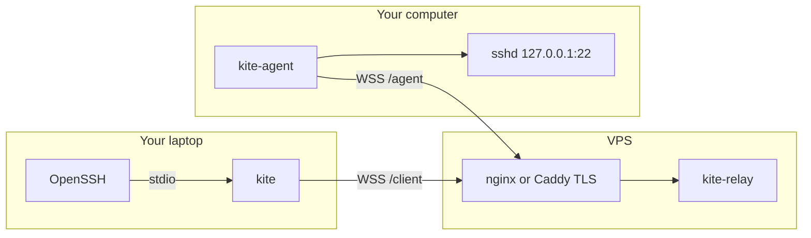
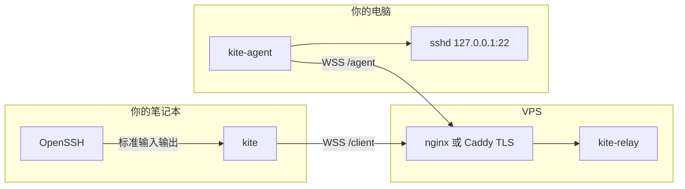

# kite

kite is a small self-hosted tunnel that carries SSH over a WebSocket (plain WS, or WSS when TLS is terminated in front). It is meant for personal access to your own computers: a relay with a public name, an agent on each machine that dials out, and an OpenSSH `ProxyCommand` on the client. One static binary each, no Cgo.

It is a lightweight alternative to frp, chisel, or Tailscale when all you want is SSH to machines you already administer.

## Binaries

| Binary | Role |
| --- | --- |
| `kite-relay` | Runs on a Linux VPS. Accepts long-lived agent WebSockets and forwards client sessions to the agent with the matching name. |
| `kite-agent` | Runs on each of your computers (Windows, Linux, macOS). Dials out to the relay and forwards streams only to the local SSH server. Reconnects with backoff. |
| `kite` | OpenSSH `ProxyCommand`. Connects to the relay, asks for one agent by name, and splices stdin/stdout so `ssh` and tools built on it work as usual. |

## Architecture



The usual deployment is plain WebSocket on `127.0.0.1:8080`, with nginx or Caddy terminating TLS. kite-relay can serve TLS itself when both `TLS_CERT_FILE` and `TLS_KEY_FILE` are set.

One WebSocket per agent carries many SSH streams. Each frame is a 5-byte header (1-byte type, 4-byte big-endian stream id) plus a payload of at most 256 KiB. An agent connection holds at most 64 streams. Ping (type 10) and pong (type 11) are exchanged every 20 seconds. A connection with no received frames for `IDLE_TIMEOUT` (default 90s) is dropped. Those application heartbeats, not TCP keepalives, are what keep an idle tunnel open through a reverse proxy.

Agents and clients present one shared `REGISTRATION_KEY`. The relay compares it in constant time and rejects anything else. A newer agent with the same name replaces the previous connection.

The agent dials only its configured `LOCAL_SSH_ADDR` (default `127.0.0.1:22`). Open frames do not carry an address. The relay cannot point the agent at another host.

## Secrets

Set `REGISTRATION_KEY` and `RELAY_ADDR` with environment variables, or with a config file that stays out of git (`~/.config/kite/config.yaml`, or `--config` / `KITE_CONFIG` pointing at a gitignored file). Never commit them.

Do not commit real registration keys, real domains, public IPs, TLS certificates, or private keys. The files in this repository use placeholders (`CHANGE_ME`, `tunnel.example.com`). kite refuses to start while the key is still `CHANGE_ME`.

`.gitignore` excludes `.env`, `*.pem`, `*.key`, `*.crt`, `config.yaml`, `config.yml`, `config.toml`, and `config.json`. Tracked examples live at `config.example.yaml` and `deploy/*.example`.

Copy `config.example.yaml` if you want a file. Environment variables override the file. Flags override both.

## Quick start

Build (or download a release, below):

```sh
make all
# bin/kite  bin/kite-agent  bin/kite-relay
```

### Relay

On the VPS, install `kite-relay` to `/usr/local/bin` and create `/etc/kite/relay.env` from `deploy/relay.env.example`. Put a long random `REGISTRATION_KEY` in that file and `chmod 600` it.

```sh
sudo install -m 755 bin/kite-relay /usr/local/bin/kite-relay
sudo install -d -m 700 /etc/kite
sudo cp deploy/relay.env.example /etc/kite/relay.env
sudoedit /etc/kite/relay.env
sudo cp deploy/kite-relay.service /etc/systemd/system/kite-relay.service
sudo systemctl daemon-reload
sudo systemctl enable --now kite-relay
```

Default listen address is `127.0.0.1:8080` with no TLS. Put nginx or Caddy in front:

- `deploy/nginx-kite.conf` passes through the WebSocket upgrade (`Upgrade` and `Connection`, `proxy_http_version 1.1`), sets `proxy_buffering off`, and uses 24 hour `proxy_read_timeout` / `proxy_send_timeout`.
- `deploy/Caddyfile` uses `reverse_proxy` with `flush_interval -1` and the same long timeouts.

The 20 second application heartbeat keeps otherwise idle SSH sessions from being cut by those proxies. `GET /healthz` returns `ok` for a local check.

To terminate TLS inside kite-relay instead, set both `TLS_CERT_FILE` and `TLS_KEY_FILE`. Leave them unset when a proxy does TLS.

### Agent

`AGENT_NAME` must match the `Host` alias you will use in SSH config. The agent never dials anywhere except `LOCAL_SSH_ADDR`.

Linux, with `/etc/kite/agent.env` copied from `deploy/agent.env.example`:

```sh
sudo install -m 755 bin/kite-agent /usr/local/bin/kite-agent
sudo cp deploy/kite-agent.service /etc/systemd/system/kite-agent.service
sudo systemctl daemon-reload
sudo systemctl enable --now kite-agent
```

macOS: copy `deploy/agent.env.example` to `~/.config/kite/agent.env` (`chmod 600`), install the binary to `/usr/local/bin/kite-agent`, then:

```sh
cp deploy/com.kite.agent.plist ~/Library/LaunchAgents/
launchctl load ~/Library/LaunchAgents/com.kite.agent.plist
```

The plist has no secrets. It sources `~/.config/kite/agent.env`.

Windows: from an elevated PowerShell, after placing `kite-agent.exe` on `PATH` or passing `-BinaryPath`:

```powershell
powershell -ExecutionPolicy Bypass -File .\deploy\install-kite-agent.ps1 `
    -RelayAddr "wss://tunnel.example.com/agent" `
    -RegistrationKey "CHANGE_ME" `
    -AgentName "my-pc"
```

Replace both placeholders before running. The script writes `start-kite-agent.cmd` under the install directory and registers a logon task. `deploy/kite-agent-task.xml` is the same task without a key, if you prefer `schtasks /Create /XML`. Do not commit the generated wrapper.

### SSH client

OpenSSH does not expand `$VARS` inside `ProxyCommand`. `%n` is the `Host` alias, and it must equal `AGENT_NAME`. `RELAY_ADDR` and `REGISTRATION_KEY` come from the environment of the `ssh` process (for example a shell profile that sources a gitignored `client.env`) or from `~/.config/kite/config.yaml`.

```
Host my-pc
  User me
  ProxyCommand kite %n
```

```sh
# ~/.config/kite/client.env  (gitignored copy of deploy/client.env.example)
set -a
. "$HOME/.config/kite/client.env"
set +a
ssh my-pc
```

`my-pc` is both the SSH host alias and the agent's `AGENT_NAME`. The same pattern works for `scp`, `sftp`, and `git` over SSH.

## Download

Release tags `v*` build static binaries for `linux/amd64`, `linux/arm64`, `windows/amd64`, `darwin/amd64`, and `darwin/arm64`. Grab them from the [GitHub Releases](https://github.com/zzzbug01/kite/releases) page. Linux and macOS archives are `.tar.gz`. Windows is `.zip`. `SHA256SUMS` lists every file.

```sh
tar -xzf kite_v0.1.0_linux_amd64.tar.gz
sudo install -m 755 kite kite-agent kite-relay /usr/local/bin
```

## Build

Requires Go 1.23 or newer.

```sh
make all     # CGO_ENABLED=0 binaries in bin/
make test    # go vet ./... and go test -race ./...
make cross   # linux/amd64, linux/arm64, windows/amd64, darwin/amd64, darwin/arm64
```

`make test` does not force `CGO_ENABLED=0`, because the race detector needs cgo. Release binaries and `make cross` always set `CGO_ENABLED=0`.

## Cut a release

Tag and push. GitHub Actions (`.github/workflows/release.yml`) cross-compiles, packages, and attaches the archives to a GitHub Release. This repository does not ship a pre-made tag.

```sh
git tag v0.1.0
git push --tags
```

## Configuration

| Variable | Binary | Default |
| --- | --- | --- |
| `LISTEN_ADDR` | relay | `127.0.0.1:8080` |
| `REGISTRATION_KEY` | all | required |
| `TLS_CERT_FILE`, `TLS_KEY_FILE` | relay | unset (plain WS) |
| `IDLE_TIMEOUT` | all | `90s` |
| `RELAY_ADDR` | agent, client | required, `ws://` or `wss://` |
| `AGENT_NAME` | agent | required |
| `LOCAL_SSH_ADDR` | agent | `127.0.0.1:22` |

Flags: `--listen`, `--registration-key`, `--tls-cert`, `--tls-key`, `--idle-timeout`, `--relay`, `--name`, `--local`, `--config`. A URL with no path becomes `/agent` for kite-agent and `/client` for kite.

---

# kite（中文）

kite 是一个自托管的轻量隧道，用 WebSocket 承载 SSH（代理终结 TLS 时就是 WSS）。它用来访问你自己的电脑：公网机器上跑中继，每台电脑上的 agent 主动向外连接，本机用 OpenSSH 的 `ProxyCommand` 接入。三个静态二进制，不依赖 Cgo。

只想 SSH 到自己管理的机器时，它可以作为 frp、chisel 或 Tailscale 的轻量替代。

## 三个程序

| 程序 | 作用 |
| --- | --- |
| `kite-relay` | 跑在 Linux VPS 上。接受 agent 的长连接，把客户端会话转给同名 agent。 |
| `kite-agent` | 跑在你的每台电脑上（Windows、Linux、macOS）。主动连向中继，只把流量转给本机 SSH。断线按退避重连。 |
| `kite` | OpenSSH 的 `ProxyCommand`。连上中继，按名字找到 agent，把标准输入输出对接过去，`ssh` 以及基于它的工具可以照常使用。 |

## 架构



常见部署是中继在 `127.0.0.1:8080` 上提供明文 WebSocket，由 nginx 或 Caddy 终结 TLS。只有同时设置 `TLS_CERT_FILE` 和 `TLS_KEY_FILE` 时，kite-relay 才自己提供 TLS。

每个 agent 一条 WebSocket，上面复用多路 SSH。帧格式是 5 字节头（1 字节类型 + 4 字节大端流编号）再加最多 256 KiB 的载荷。一条 agent 连接最多 64 路。每 20 秒交换一次 ping（类型 10）和 pong（类型 11）。`IDLE_TIMEOUT`（默认 90 秒）内没有收到任何帧就断开。穿过反向代理时，靠的是这个应用层心跳，而不是 TCP keepalive。

agent 和客户端出示同一个 `REGISTRATION_KEY`。中继用常数时间比较，其他值一律拒绝。同名 agent 新连接会替换旧连接。

agent 只拨自己配置的 `LOCAL_SSH_ADDR`（默认 `127.0.0.1:22`）。打开流的帧里不带地址，中继不能让 agent 去连别的地方。

## 密钥

`REGISTRATION_KEY` 和 `RELAY_ADDR` 用环境变量设置，或者放在不进 git 的配置文件里（`~/.config/kite/config.yaml`，或 `--config` / `KITE_CONFIG` 指向被 gitignore 的文件）。不要把它们提交进仓库。

不要提交真实的注册密钥、真实域名、公网 IP、TLS 证书或私钥。仓库里的示例只用占位符（`CHANGE_ME`、`tunnel.example.com`）。密钥如果还是 `CHANGE_ME`，程序会拒绝启动。

`.gitignore` 排除 `.env`、`*.pem`、`*.key`、`*.crt`、`config.yaml`、`config.yml`、`config.toml` 和 `config.json`。会进仓库的示例是 `config.example.yaml` 和 `deploy/*.example`。

需要文件时复制 `config.example.yaml`。环境变量覆盖文件，命令行参数再覆盖环境变量。

## 快速开始

编译，或从下面的 Release 下载：

```sh
make all
# bin/kite  bin/kite-agent  bin/kite-relay
```

### 中继

在 VPS 上把 `kite-relay` 装到 `/usr/local/bin`，用 `deploy/relay.env.example` 生成 `/etc/kite/relay.env`，写入一长串随机 `REGISTRATION_KEY`，并 `chmod 600`。

```sh
sudo install -m 755 bin/kite-relay /usr/local/bin/kite-relay
sudo install -d -m 700 /etc/kite
sudo cp deploy/relay.env.example /etc/kite/relay.env
sudoedit /etc/kite/relay.env
sudo cp deploy/kite-relay.service /etc/systemd/system/kite-relay.service
sudo systemctl daemon-reload
sudo systemctl enable --now kite-relay
```

默认监听 `127.0.0.1:8080`，不启用 TLS。前面加 nginx 或 Caddy：

- `deploy/nginx-kite.conf` 透传 WebSocket 升级（`Upgrade` 和 `Connection`，`proxy_http_version 1.1`），关闭 `proxy_buffering`，`proxy_read_timeout` / `proxy_send_timeout` 为 24 小时。
- `deploy/Caddyfile` 使用 `reverse_proxy`，`flush_interval -1`，超时同样很长。

20 秒一次的应用层心跳让空闲 SSH 不会被这些代理掐断。`GET /healthz` 返回 `ok`，便于本机检查。

如果要让 kite-relay 自己终结 TLS，同时设置 `TLS_CERT_FILE` 和 `TLS_KEY_FILE`。由代理做 TLS 时就不要设置它们。

### Agent

`AGENT_NAME` 必须和 SSH 配置里的 `Host` 别名一致。agent 除了 `LOCAL_SSH_ADDR` 不会拨其他地址。

Linux：把 `deploy/agent.env.example` 复制为 `/etc/kite/agent.env` 后：

```sh
sudo install -m 755 bin/kite-agent /usr/local/bin/kite-agent
sudo cp deploy/kite-agent.service /etc/systemd/system/kite-agent.service
sudo systemctl daemon-reload
sudo systemctl enable --now kite-agent
```

macOS：把 `deploy/agent.env.example` 复制到 `~/.config/kite/agent.env`（`chmod 600`），二进制放到 `/usr/local/bin/kite-agent`，然后：

```sh
cp deploy/com.kite.agent.plist ~/Library/LaunchAgents/
launchctl load ~/Library/LaunchAgents/com.kite.agent.plist
```

这个 plist 里没有密钥，它会读取 `~/.config/kite/agent.env`。

Windows：在提升权限的 PowerShell 里，把 `kite-agent.exe` 放到 `PATH` 上，或传入 `-BinaryPath`：

```powershell
powershell -ExecutionPolicy Bypass -File .\deploy\install-kite-agent.ps1 `
    -RelayAddr "wss://tunnel.example.com/agent" `
    -RegistrationKey "CHANGE_ME" `
    -AgentName "my-pc"
```

运行前换掉两个占位符。脚本会在安装目录写下 `start-kite-agent.cmd`，并注册登录时启动的计划任务。`deploy/kite-agent-task.xml` 是不含密钥的同一任务，可以用 `schtasks /Create /XML` 导入。不要提交生成出来的包装脚本。

### SSH 客户端

OpenSSH 不会展开 `ProxyCommand` 里的 `$变量`。`%n` 是 `Host` 别名，必须等于 `AGENT_NAME`。`RELAY_ADDR` 和 `REGISTRATION_KEY` 来自 `ssh` 进程的环境（例如在 shell 配置里 source 一份不进 git 的 `client.env`），或者来自 `~/.config/kite/config.yaml`。

```
Host my-pc
  User me
  ProxyCommand kite %n
```

```sh
# ~/.config/kite/client.env  （deploy/client.env.example 的副本，不要提交）
set -a
. "$HOME/.config/kite/client.env"
set +a
ssh my-pc
```

`my-pc` 既是 SSH 主机别名，也是这台电脑的 `AGENT_NAME`。`scp`、`sftp` 和走 SSH 的 `git` 同样适用。

## 下载

标签 `v*` 会为 `linux/amd64`、`linux/arm64`、`windows/amd64`、`darwin/amd64`、`darwin/arm64` 打静态二进制。从 [GitHub Releases](https://github.com/zzzbug01/kite/releases) 下载。Linux 和 macOS 是 `.tar.gz`，Windows 是 `.zip`，`SHA256SUMS` 列出全部文件。

```sh
tar -xzf kite_v0.1.0_linux_amd64.tar.gz
sudo install -m 755 kite kite-agent kite-relay /usr/local/bin
```

## 编译

需要 Go 1.23 或更新版本。

```sh
make all     # bin/ 下的 CGO_ENABLED=0 二进制
make test    # go vet ./... 以及 go test -race ./...
make cross   # linux/amd64、linux/arm64、windows/amd64、darwin/amd64、darwin/arm64
```

`make test` 不会强制 `CGO_ENABLED=0`，因为竞态检测需要 cgo。发布用的二进制和 `make cross` 始终设置 `CGO_ENABLED=0`。

## 打一个版本

打标签并推送。GitHub Actions（`.github/workflows/release.yml`）会交叉编译、打包，并把压缩包挂到 GitHub Release 上。这个仓库本身不带现成的 tag。

```sh
git tag v0.1.0
git push --tags
```

## 配置

| 变量 | 程序 | 默认 |
| --- | --- | --- |
| `LISTEN_ADDR` | 中继 | `127.0.0.1:8080` |
| `REGISTRATION_KEY` | 全部 | 必填 |
| `TLS_CERT_FILE`、`TLS_KEY_FILE` | 中继 | 不设置（明文 WS） |
| `IDLE_TIMEOUT` | 全部 | `90s` |
| `RELAY_ADDR` | agent、客户端 | 必填，`ws://` 或 `wss://` |
| `AGENT_NAME` | agent | 必填 |
| `LOCAL_SSH_ADDR` | agent | `127.0.0.1:22` |

对应参数：`--listen`、`--registration-key`、`--tls-cert`、`--tls-key`、`--idle-timeout`、`--relay`、`--name`、`--local`、`--config`。URL 没有路径时，kite-agent 使用 `/agent`，kite 使用 `/client`。
